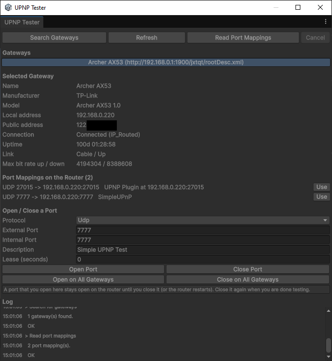
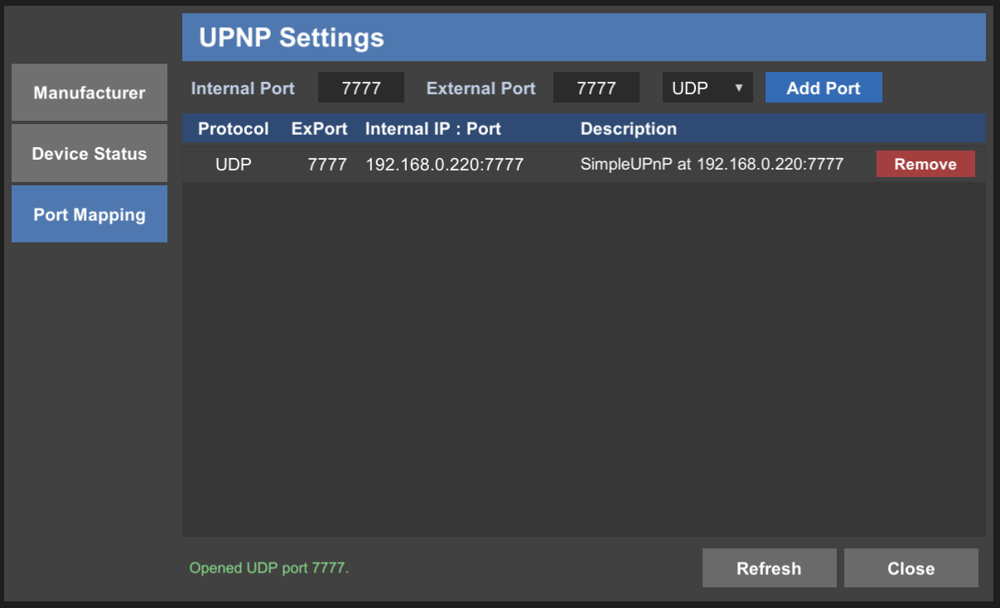
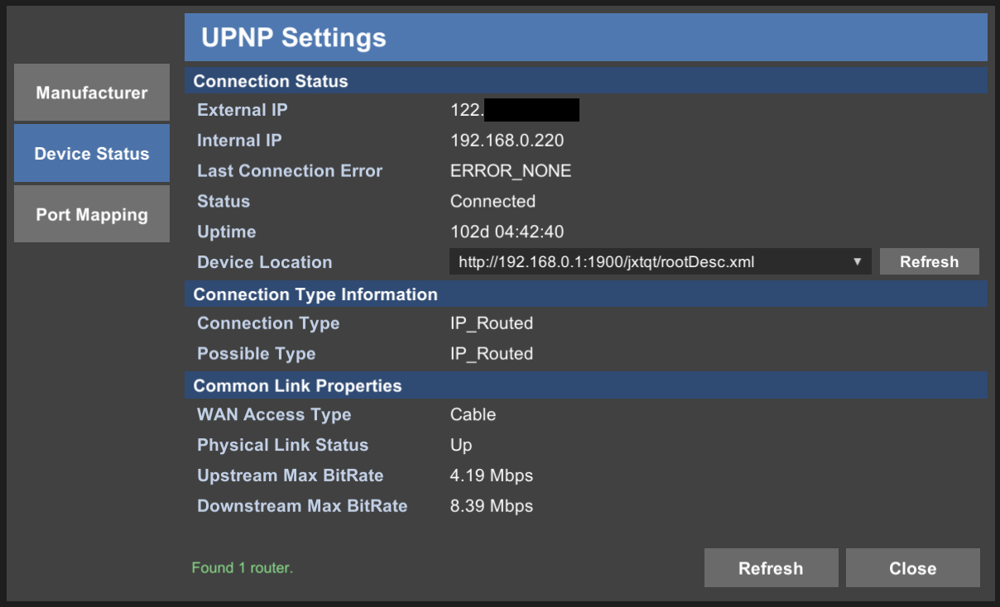
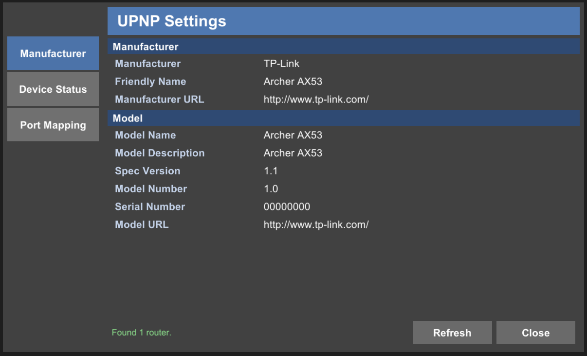

# Simple UPNP

코드 한 줄로 플레이어의 라우터(공유기) 포트를 열어, **수동 포트 포워딩 없이도** 다른 플레이어들이 게임에 접속할 수 있도록 합니다.

Simple UPNP는 SSDP를 통해 인터넷 게이트웨이 장치(라우터)를 검색하고, 제조사, 상태 및 링크 정보를 읽어오며, UPnP IGD SOAP 서비스(`WANIPConnection` / `WANPPPConnection`)를 통해 **UDP / TCP 포트 매핑**을 추가, 삭제 및 조회합니다. 네이티브 플러그인, 외부 서비스, 계정이 필요 없는 순수 C# 라이브러리입니다. 라우터에 요청하는 포트 매핑 외에는 어떠한 데이터도 로컬 네트워크 외부로 유출되지 않습니다.

* **네트워크 라이브러리와 독립적**: 라우터의 포트만 열어줄 뿐이며, 사용 중인 트랜스포트(Unity Transport, Mirror, LiteNetLib, 자체 소켓, 가정용 PC의 데디케이티드 서버 등)는 평소대로 해당 포트에서 수신 대기합니다.
* **드롭인 `UpnpManager` 컴포넌트**: 인스펙터 설정 및 UnityEvent 지원, **또는** `async`/`await` API, **또는** 엔진 독립적인 `UpnpClient`(`UnityEngine` 참조 없음)를 제공합니다.
* **예외를 발생시키지 않는 API**: 모든 호출은 에러 코드와 읽을 수 있는 메시지가 포함된 결과를 반환합니다.
* **자동 정리**: 게임이 종료될 때 컴포넌트가 열었던 포트를 다시 닫아 깔끔하게 정리합니다.
* **게이트웨이 테스터 창** (**Window > Simple UPNP > Gateway Tester**): 에디터 상에서 라우터를 직접 테스트해볼 수 있습니다.
* 데모 샘플, 단위 테스트, 전체 소스 코드가 포함되어 있습니다.

<p align="center">
  <br>
  <sub>UPnP 테스터</sub>
</p>

언리얼 엔진용 *SimpleUPNP* 플러그인([github.com/woodsshin/UPNPSample](https://github.com/woodsshin/UPNPSample))의 유니티 버전입니다.

## 요구 사항

* Unity 2022.3 이상 (C# 9).
* 지원 플랫폼: Windows, macOS, Linux, Android, iOS* 빌드 및 에디터. 순수 매니지드 코드로 구성되어 있으며 네이티브 플러그인이 없습니다.
* 라우터의 UPnP 기능이 활성화되어 있어야 하며(대부분의 가정용 라우터는 기본적으로 활성화되어 있음), 공인 IP 주소를 가지고 있어야 합니다.

\* iOS의 경우 Apple의 *Multicast Networking* 권한이 필요합니다. 자세한 내용은 [플랫폼 참고 사항](Assets/com.woodsshin.simpleupnp/Documentation~/SimpleUPNP.md#platform-notes)을 참조하세요.
WebGL은 소켓을 열 수 없으므로 지원되지 않습니다.

## 노코드 시작 가이드

1. **GameObject > Create Empty** 생성 후, **Add Component > Simple UPNP > UPNP Manager**를 추가합니다.
2. *Startup Mappings* 목록에서 게임의 프로토콜과 포트(예: **UDP 7777**)를 설정합니다.
3. **Discover On Start** 및 **Open Startup Mappings On Start** 체크박스를 활성화합니다.
4. Play 버튼을 누릅니다. 콘솔에 `[Simple UPNP] Added UDP port mapping 7777 -> 192.168.x.x:7777 on <your router>` 메시지가 출력됩니다. 게임을 정지하면 매핑이 다시 제거됩니다.

## 스크립트 시작 가이드

```csharp
using UnityEngine;
using WoodsShin.SimpleUPNP;

public class HostGame : MonoBehaviour
{
    private async void Start()
    {
        UpnpManager upnp = UpnpManager.GetOrCreate();

        // 필요한 경우 라우터를 먼저 검색한 후, UDP 7777 -> 이 컴퓨터로 포트를 엽니다.
        UpnpResult result = await upnp.OpenPortAsync(UpnpProtocol.Udp, 7777, description: "My Game");

        if (result.Succeeded)
        {
            await upnp.RefreshGatewayAsync();   // 라우터의 공인 IP 주소도 함께 읽어옵니다.
            Debug.Log("플레이어가 접속할 수 있는 주소: " + upnp.SelectedGateway.ExternalIPAddress + ":7777");
        }
        else
        {
            // 포트 열기에 실패했을 때 플레이어에게 안내할 내용을 작성합니다 (예: "수동으로 포트를 포워딩하세요").
            Debug.LogWarning("포트를 열 수 없습니다: " + result);
        }
    }
}
```

`await` 이후 처리는 유니티 메인 스레드에서 복귀하므로, 실행 직후 유니티 객체들을 바로 다룰 수 있습니다.
게임을 종료할 때 포트는 자동으로 다시 닫힙니다 (*Close Mappings On Quit* 옵션으로 이 동작을 끌 수 있습니다).

## 데모 샘플 미리보기

패키지에 포함된 데모 샘플을 통해 포트 매핑, 장치 상태 조회, 제조사 정보 확인 기능을 UI로 테스트 할 수 있습니다.

| 포트 매핑 (Port Mapping) | 장치 상태 (Device Status) | 제조사 정보 (Manufacturer) |
| :---: | :---: | :---: |
|  |  |  |

## 패키지 구성 요소

| 폴더 | 내용 |
| --- | --- |
| `Runtime/Core` | 엔진 독립적인 C# 라이브러리 (`UpnpClient`, `UpnpGateway`, SSDP, SOAP). 어셈블리: `WoodsShin.SimpleUPNP.Core`. |
| `Runtime/Unity` | `UpnpManager` 컴포넌트. 어셈블리: `WoodsShin.SimpleUPNP.Runtime`. |
| `Editor` | 게이트웨이 테스터 창. 어셈블리: `WoodsShin.SimpleUPNP.Editor`. |
| `Tests/Editor` | 로컬 머신의 가상 라우터를 대상으로 실행되는 단위 테스트. 어셈블리: `WoodsShin.SimpleUPNP.Tests`. |
| `Samples~/Demo` | IMGUI 데모. **Package Manager > Simple UPNP > Samples**에서 임포트할 수 있습니다. |
| `Documentation~` | 매뉴얼 문서: [SimpleUPNP.md](Packages/com.woodsshin.simpleupnp/Documentation~/SimpleUPNP.md). |

## 문서

인스펙터 레퍼런스, API 레퍼런스, 에러 코드, 플랫폼 참고 사항, 보안 관련 사항 및 문제 해결 방법이 포함된 전체 매뉴얼은 [Documentation~/SimpleUPNP.md](Packages/com.woodsshin.simpleupnp/Documentation~/SimpleUPNP.md)를 참조하세요.